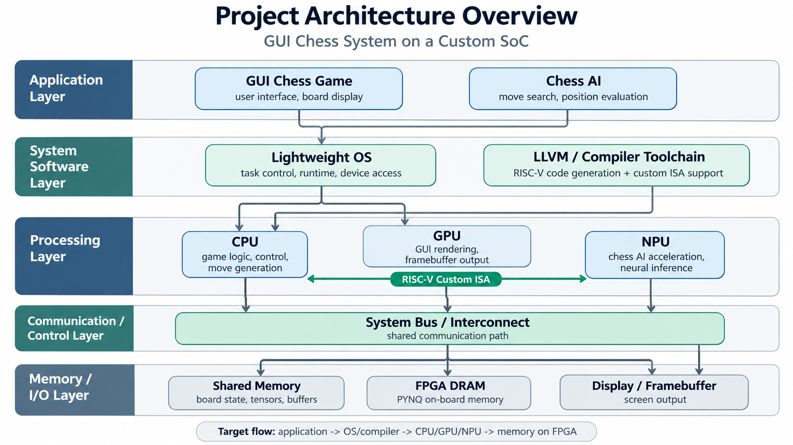

# PPA LAB Team 2 - Chess SoC

FPGA에서 GUI 체스 게임과 체스 AI를 실행하기 위한 RISC-V 기반 SoC 프로젝트입니다.

CPU, GPU, NPU, 메모리 시스템을 하나로 연결하고, NPU 제어용 RISC-V Custom ISA와 LLVM 기반 컴파일러 지원, 경량 OS를 함께 구성합니다. 게임 로직과 탐색은 CPU가, 화면 렌더링은 GPU가, 체스 AI의 신경망 평가는 NPU가 담당하는 구조를 목표로 합니다.

## 시스템 아키텍처

특정 코어나 제품명 대신 CPU, GPU, NPU 등 기능 단위로 표현했으며, 상세 인터페이스와 물리 메모리 배치는 향후 구체화 예정입니다.   

| 구성 요소 | 역할 |
| --- | --- |
| **GUI Chess Game** | 체스판과 기물 표시, 사용자 입력, 게임 상태 관리 |
| **Chess AI** | 가능한 수 탐색과 보드 평가를 통해 다음 수 결정 |
| **CPU** | 경량 OS와 게임 프로그램 실행, 탐색 제어, GPU·NPU 작업 요청 |
| **GPU** | 체스판·기물·UI 렌더링 및 프레임버퍼 갱신 |
| **NPU** | 체스 AI의 보드 평가에 사용하는 신경망 추론 가속 |
| **System Bus / Interconnect** | CPU·GPU·NPU와 메모리·입출력 장치 사이의 데이터 전달 및 접근 중재 |
| **Memory / I/O** | 프로그램, 게임 상태, 모델 가중치, 연산 버퍼, 화면 데이터 저장 및 출력 |

### Custom ISA · Compiler · OS

**RISC-V Custom ISA**는 CPU가 NPU에 연산을 요청하고 결과를 확인하기 위한 명령어를 정의합니다. NPU에 작업을 지시하는 제어 경로와 입력·출력 데이터를 옮기는 메모리 경로를 설계할 예정입니다.

**LLVM 기반 Toolchain**은 NPU 명령어를 사용하는 RISC-V 프로그램을 빌드하기 위한 컴파일러 지원을 담당합니다. 그림의 LLVM 블록은 개발 도구를 나타내며, 게임 실행 중 매번 거치는 처리 단계는 아닙니다.

**경량 OS**는 프로그램 실행과 장치 접근을 위한 환경을 제공합니다. 체스 게임이 GPU·NPU·메모리를 사용할 수 있도록 필요한 제어 소프트웨어를 함께 구성할 예정입니다.

### 메모리와 화면 출력

메모리는 PYNQ 보드 자원을 최대한 활용하는 방향으로 설계합니다. CPU·GPU·NPU가 사용할 공유 데이터와 각 장치의 연산 버퍼, 프레임버퍼를 관리하고, 장치 사이의 데이터 전달과 완료 확인하는 방식으로 작동합니다.

그림의 **Shared Memory**는 장치들이 데이터를 공유하는 역할을, **FPGA DRAM**은 보드의 메모리 자원을 나타냅니다. 두 표기가 반드시 서로 다른 물리 메모리를 뜻하는 것은 아니며, 실제 배치와 접근 경로는 메모리 설계에서 정해야 합니다.

## 체스 프로그램 실행 흐름

1. 경량 OS에서 체스 프로그램을 실행하고 사용자 입력을 받습니다.
2. CPU가 게임 상태를 갱신하고 AI의 다음 수를 탐색합니다.
3. 탐색 중 신경망 평가가 필요한 보드 상태를 준비하고, Custom ISA로 NPU에 연산을 요청합니다.
4. NPU가 데이터를 읽어 추론한 뒤 결과를 전달하면, CPU가 탐색을 이어가 다음 수를 결정합니다.
5. GPU가 변경된 체스판을 렌더링하고 프레임버퍼를 갱신해 화면에 반영합니다.

NPU에 옮기는 대상은 체스 AI 전체가 아니라 **신경망 기반 평가 연산**입니다. 게임 규칙과 수 탐색은 CPU에 두고, 평가 연산을 분리해 가속 효과를 확인합니다.

## 개발 범위와 검증 기준

RTL 시뮬레이션에서 각 모듈과 연결을 검증한 뒤 FPGA 실행으로 확장합니다. 개별 장치의 동작과 전체 시스템의 실행을 구분해 확인합니다.

| 개발 범위 | 확인할 결과 |
| --- | --- |
| CPU·메모리 기본 시스템 | 프로그램 실행과 메모리 읽기·쓰기 |
| Custom ISA·NPU 연동 | 명령어 요청·완료 처리, 소프트웨어 기준 결과와 일치 |
| GPU·화면 출력 | 체스판 렌더링, 프레임버퍼 갱신, 화면 표시 |
| Compiler·OS 연동 | 빌드한 프로그램이 대상 시스템에서 장치를 사용하며 실행 |
| 체스 AI 가속 | 같은 신경망·입력 조건에서 CPU 실행과 NPU 실행의 정확성·시간 비교 |
| FPGA 통합 데모 | 보드에서 GUI 체스 게임과 AI 대전 실행 |

## Baseline Model 및 성능 평가 지표
**ROCKET Chip** 만을 이용해서 Chess AI를 돌렸을 때와 우리의 **Rocket Chip based SoC**를 이용해서 Chess AI를 돌렸을 때의 **AI 응답 시간 및 처리량**이 주요 평가 대상입니다.

가속 성능은 NPU 내부 연산 시간뿐 아니라 명령 전달, 데이터 이동, 완료 대기 시간을 포함해 평가합니다. 최종적으로는 평가 함수의 실행 시간과 전체 체스 탐색 시간을 함께 비교합니다.

## 구현목표 및 순서
#### 1. SoC 설계   
#### 2. SoC + OS + Compiler   
#### 3. SoC + ChessAI Game   

## 팀 구성

| 팀원 | 담당 분야 |
| --- | --- |
| 공통 | Architecture, OS, Compiler, Interconnection(BUS)
| 문범용 | CPU / SoC |
| 김진목 | SRAM / DRAM / CXL |
| 정세헌 | NPU |
| 탁효빈 | GPU |

